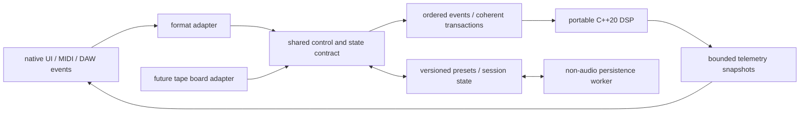

# SYS 01 // 1.0.0 AUDIT AND DELIVERY PLAN

audit date: 2026-10-09. scope: current local source, build verification, native adapter contracts, brand records, tape 01 specifications, and the locally rendered website. this is an audit and proposed plan; it does not change the product contract or implement the release.

**assessment: a credible shared sound engine with an unfinished product around it.** the portable DSP deserves to be retained. the largest gap is the path from a musician's action through a host adapter to sound, feedback, recall, and a reproducible installed release. a visual redesign alone cannot close that gap.

| area | observed status | requirement for 1.0.0 |
|---|---|---|
| portable DSP | substantial implementation and passing host tests | preserve boundaries; prove musical and timing behavior through shipping adapters |
| max integration | incomplete scaffold; supplied patch has broken control messages | repair, then validate in max/live if included in the release |
| VST3 / AU / CLAP / standalone | described or anticipated, no implemented adapters found | choose a supported format set and build it |
| native UX/UI | plain patch controls; visual assets are placeholders | a complete, accessible, host-integrated instrument interface |
| product identity | strong tape vocabulary; contradictory names and contracts | one ratified identity and executable control specification |
| development/release | good core checks; no tracked git baseline; incomplete packaging | traceable source, platform coverage, release artifacts and retained evidence |
| tape hardware | shared engine plus a firmware probe | independent board implementation and hardware qualification |

**evidence established during this audit.** clean out-of-tree builds on macos arm64 with apple clang 21 passed all six CTest groups in both release and debug ASan/UBSan configurations. the unit suite passed 27 cases and 662,569 assertions. checks cover WAV output, the firmware memory contract, unit behavior, realtime allocation/concurrency, forbidden runtime symbols, and short DSP stress. measured host storage was 262,824 bytes for the engine and 265,896 bytes including I/O. the earlier eight-hour-per-domain results remain historical evidence from 2026-10-08; this audit did not rerun them, TSAN, formatting, or static analysis.

the website was inspected visually at `/sys-0` and `/tape-01`. its cassette is explicitly a silent control preview and its audio examples are fixed native renders. it is not a native plugin, a browser DSP engine, or a validated software UI. max/live loading, Windows, plugin validators, listening sessions, and physical hardware were not exercised. passing core tests is not evidence that these surfaces work.

**confirmed gaps, ordered by release impact.** P1 means a blocker for a shipping product that includes the affected capability; P2 means a quality or reproducibility gap to close before release.

| priority | finding and consequence | evidence | required action |
|---|---|---|---|
| P1 | the visible max controls send `time`, `form`, `play`, and `mode`, while the external accepts `flux`, `bias`, `drive`, and `state`. all four selectors fail the structural comparison; DRIVE remains at its zero default. | [patch](/Users/lhommeduchili/algorhythmia/sys-01/apps/max_for_live/patchers/study01.maxpat:143), [external registrations](/Users/lhommeduchili/algorhythmia/sys-01/apps/max_for_live/external/algorhythmia_tilde.cpp:147) | repair the patch contract; add a patch-to-external regression check and an actual host sound test |
| P1 | the adapter forwards scalar values but does not expose raw gestures, MIDI delivery, telemetry, commit consumption, presets, bypass, or host clock. the core already implements some of these boundaries. | [adapter callback](/Users/lhommeduchili/algorhythmia/sys-01/apps/max_for_live/external/algorhythmia_tilde.cpp:78), [engine API](/Users/lhommeduchili/algorhythmia/sys-01/libs/algorhythmia_dsp/include/algorhythmia/engine.hpp:45) | complete a host-neutral control/state layer and thin format adapters |
| P1 | latest-value mailboxes sampled at process boundaries cannot preserve arbitrary intermediate events. a 64-frame conversion loop does not make automation sample accurate. | [architecture contract](/Users/lhommeduchili/algorhythmia/sys-01/docs/architecture.md:13) | schedule ordered events with sample offsets; define event limits, overflow behavior, and smoothing semantics; test the shipping wrapper |
| P1 | save/restore is not a finished product feature. the commit word contains quantized controls, not complete tape/voice/phase state; there is no atomic preset restore API or schema migration. max graph rebuild calls `init()` and clears history. | [snapshot fields](/Users/lhommeduchili/algorhythmia/sys-01/libs/algorhythmia_dsp/include/algorhythmia/engine.hpp:31), [graph rebuild](/Users/lhommeduchili/algorhythmia/sys-01/apps/max_for_live/external/algorhythmia_tilde.cpp:111) | define exactly what session recall preserves; publish coherent state changes; make reset and graph-rebuild behavior deliberate |
| P1 | STATE means a binary sub-register in the engine, but a three-domain selector in the software UI spec. host sync, bypass, master gain, clock subdivisions, and several button chords are specified but absent. | [scene contract](/Users/lhommeduchili/algorhythmia/sys-01/docs/scenes.md:13), [software parameter table](/Users/lhommeduchili/algorhythmia/sys-01/docs/vst-reference-ui-spec.md:62), [hardware gestures](/Users/lhommeduchili/algorhythmia/tape-01/specs/physical-and-industrial-design.md:211) | ratify one feature/gesture matrix; implement or explicitly defer every conflicting promise |
| P1 | there is no finished native interface or distributable host product. the max patch opens outside presentation mode; the UI/art directories contain README placeholders. | [patch settings](/Users/lhommeduchili/algorhythmia/sys-01/apps/max_for_live/patchers/study01.maxpat:18), [UI placeholder](/Users/lhommeduchili/algorhythmia/sys-01/apps/max_for_live/ui/README.md:1), [adapter status](/Users/lhommeduchili/algorhythmia/sys-01/apps/max_for_live/README.md:3) | complete the instrument workflow and package a tested artifact |
| P1 | source provenance and distribution rights are unfinished: no commits or tracked files in this checkout, no first-party license/notice found, and independent version declarations still say 0.1.0. the UI document's 1.0.0 is a specification version. | `git log`, `git ls-files`, [project version](/Users/lhommeduchili/algorhythmia/sys-01/CMakeLists.txt:3), [licensing boundary](/Users/lhommeduchili/algorhythmia/sys-01/README.md:62) | create a reviewed source baseline, resolve rights/notices, centralize versions, and publish release evidence from a tagged revision |
| P2 | root-anchored ignores miss nested DSP builds. source packaging expects lint/workflow files under `sys-01`, while they live at workspace root. the existing 0.1.0 archive differs from 29 current source files. | [ignores](/Users/lhommeduchili/algorhythmia/.gitignore:2), [packager roots](/Users/lhommeduchili/algorhythmia/sys-01/scripts/package_source.py:15) | fix source-root ownership and exclusions; extract and build the actual source export in CI |
| P2 | CI validates the core on clang/Linux/macOS, but not Windows, shipping adapters, host recall, GUI behavior, installation, or release binaries. | [workflow](/Users/lhommeduchili/algorhythmia/.github/workflows/ci.yml:10) | add the declared shipping platforms, format validators, wrapper tests and retained release reports |

the realtime design is a strength: a dependency-free C++20 core, fixed scene ownership, always-lock-free 32-bit atomics, finite-input handling, bounded storage, deliberate floating-point settings, allocation checks, and tests for partitioning, stereo behavior, gestures, and concurrency. keep this design. there is no evidence here that a framework rewrite would improve it.

the existing commit mailbox deliberately coalesces requests and has an eight-bit generation counter; 256 identical unconsumed requests can become invisible. that documented embedded compromise must not silently become the desktop save protocol. similarly, deterministic rendering in a tested build does not establish bit-identical output across all compilers and CPUs.

three less visible interaction decisions also need tests before freezing the contract. the current engine shares one binary STATE value across domains, rather than remembering a separate value for each. a STATE press captures the requested BIAS target, so a smoothing ramp can continue even though the documentation says it freezes the audible value. a two-second save during domain preview captures the old active domain, because domain selection takes effect on release. these are source-observed behaviors, not independently reproduced audible defects; decide the intended behavior and test it. [gesture handling](/Users/lhommeduchili/algorhythmia/sys-01/libs/algorhythmia_dsp/src/engine.cpp:97), [commit packing](/Users/lhommeduchili/algorhythmia/sys-01/libs/algorhythmia_dsp/src/engine.cpp:84).

**identity alignment needs decisions before implementation.** the workspace contains `study 01`, `SYS 01`, and public `SYS 0`. the master strategy says hardware first and defers software packaging, while the website presents a software-first release. use the user's SYS 01 name as this plan's working label, then explicitly settle the public name, aliases, plugin identifiers, installer names, and strategy revision. keep the website's established full-release-at-no-charge policy unless the product owner changes it.

the [software UI specification](/Users/lhommeduchili/algorhythmia/sys-01/docs/vst-reference-ui-spec.md:18) asks for an exact hardware representation, while the [brand system](</Users/lhommeduchili/algorhythmia/brand book & strategy/brand-aesthetic-system.md>) asks for precise vector controls and rejects fake physical decoration. reconcile these as shared geometry, semantics, and material restraint. the hardware's smoked polycarbonate and ENIG traces can inspire planar depth and a sparse signal schematic. a native performance interface does not need imitation screws, fake ports, glass blur, or simulated spinning reels. the 100.4:63.8 cassette envelope is approximately 1.574; the central 20:12.36 display is the approximately golden rectangle. keep those distinct in the specification.

range conflicts also affect the relationship between the twins: the physical specification lists cellular 20–360 BPM and live loop length 1–2000 ms, while the implemented engine maps FLUX to 30–300 BPM and −2× to +2× tape velocity. the website acknowledges this discrepancy, but the source specifications need the same explicit revision. [physical mappings](/Users/lhommeduchili/algorhythmia/tape-01/specs/physical-and-industrial-design.md:130).

**proposed 1.0.0 product scope.** pending format preference, use VST3 on macos/Windows and AU on macos as the planning baseline, with max for live as a following milestone and standalone as a development harness. this is a recommendation, not an approved support promise. defer CLAP, AAX, a public standalone edition, and hardware release qualification unless selected deliberately. finish one format as an end-to-end vertical slice before expanding the matrix.

prove audio routing early: bytebeat and cellular generate audio, while transform requires an input. decide whether one stereo effect shell meets the promised host workflows or separate instrument/FX variants are needed. test this in the intended DAWs before freezing plugin identifiers and presets. audio generation must work when input is silent; input-dependent modes must clearly show missing input. choose exact supported OS, CPU architecture, DAW, and format versions in the release manifest after that spike.

retain the three domains and four physical controls. add explicit desktop domain selection, output trim, bypass, presets/session recall, useful MIDI mapping, undo/redo, and host sync where promised. preserve wet-only transform as the core behavior; decide whether a desktop mix control is needed without changing the hardware contract accidentally. settle parameter-only recall versus captured-audio recall explicitly. for the lean release, restore controls and documented deterministic initialization; add captured-loop persistence only if the product promise requires it.

**target architecture: one musical source, explicit host boundaries.** evaluate JUCE as the default desktop wrapper and native vector UI framework: its documented format support, CMake integration and accessibility hooks fit this project. record the framework choice and review its applicable terms before adopting it. this recommendation does not imply that a generic framework parameter listener delivers sample-accurate automation; prove the selected wrapper's event path. [JUCE features](https://juce.com/features/), [JUCE legal resources](https://juce.com/legal/).

| boundary | responsibility | acceptance condition |
|---|---|---|
| parameter catalogue | stable IDs, defaults, units, mappings, automation flags, domain/sub-register distinction, schema version | adapters, UI and documentation derive from one validated catalogue; released IDs never change meaning |
| event ingestion | ordered sample offsets, deterministic tie-breaking, raw button edges, host timeline and MIDI | no lost supported edges; no allocation or unbounded work on audio; declared overflow policy tested |
| audio owner | scene state, ramps, event application, render; continuous and discrete changes handled explicitly | coherent preset application at a defined boundary; UI does not access mutable DSP state |
| state service | versioned bounded payload, validation, migration, restore policy and preset metadata | malformed/future/old states fail safely; project reopen reproduces the documented sound/state |
| telemetry | register, domain, run/brake/preview status, input/output level and clip; clock phase only if implemented | UI consumes bounded snapshots at its own refresh rate; every visible status has a real source |
| persistence | host session serialization and optional file/board saves outside audio | request/accepted/saved/failed states are distinguishable; a visual confirmation means the stated operation finished |
| formats | lifecycle, bus layout, transport, sample conversion, host gesture notifications and packaging | no musical algorithm duplication; shared conformance fixtures pass for every shipped format |

VST3 sends automation points with offsets and leaves their realization to the plugin. define curve interpolation separately from the existing 10 ms smoothing; timing precision and smoothing are different contracts. [Steinberg parameters and automation](https://steinbergmedia.github.io/vst3_dev_portal/pages/Technical%2BDocumentation/Parameters%2BAutomation/Index.html).

**proposed UX direction: make the computation playable and legible.** SYS 01 should be recognizable by the relationship between two spools and one changing register. its distinctive character should come from the musician seeing and hearing the same process: equation bits for bytebeat, the selected rule for cellular, and stereo energy for transform.

| surface | proposed behavior |
|---|---|
| primary performance panel | FLUX left, BIAS right, eight-element register centrally, DRIVE/STATE diagonally below; preserve the tape spatial grammar at every scale |
| musical context | an always-visible domain selector and exact mapped values: ticks/s, BPM or speed ratio; rule/azimuth/recursion as appropriate; show when one macro changes multiple properties |
| host strip | preset name and modified state, undo/redo, sync/free mode when implemented, output trim, bypass and real meters; put diagnostic sample/buffer details in an inspector |
| gesture feedback | label tap/hold functions on focus or hover; show brake, preview domain, hold progress, commit request and actual save result; release/cancel behavior is predictable |
| desktop equivalents | every hold/chord operation has a direct keyboard/menu/control equivalent; hold gestures remain an expressive shortcut |
| recovery | explicit reset, undo, preset recall, missing-input guidance and clear write-failure states; no silent destruction of a captured performance |
| optional inspector | actual equation/rule/signal-path context, MIDI assignments and engineering detail; primary performance remains uncluttered |

use obsidian/basalt planes, bone text, hairline structure, disciplined condensed/sans/mono typography, and small functional accents. keep amber/green/cyan domain semantics with text and position as redundant cues. resolve the permitted ENIG-gold material accent and a licensed condensed-font choice in shared tokens; avoid independent copies of palette and mappings. lower-case prose, upper-case labels, and the lower-case `algorhythmia` wordmark provide continuity.

prefer vertical drag by default, with fine adjustment, direct numeric entry, reset-to-default, keyboard steps and visible focus. circular drag can be optional. do not hijack Tab for STATE: it must remain focus navigation. do not seize the DAW's spacebar transport globally. custom dials need accessible roles, names, values and actions. use text contrast of at least 4.5:1 for normal labels and 3:1 for large text as design targets, and never make color the only state cue; validate native assistive technology separately. [W3C contrast guidance](https://www.w3.org/WAI/WCAG22/Understanding/contrast-minimum.html), [W3C use of color](https://www.w3.org/WAI/WCAG22/Understanding/use-of-color.html).

prototype the existing 640×440 target, a roomier working size, and 125/150/200% scaling in actual hosts before locking dimensions. use input response within one rendered UI frame under normal load, bounded 30–60 Hz telemetry updates as measured, and stop unnecessary redraws when the editor is closed. reduced motion must preserve state visibility. measure GUI-open versus GUI-closed audio performance. no animation may stand in for unavailable audio or clock information.

build a small authored preset collection organized as studies of each domain, with musical purpose and a recoverable starting point. test the first minute: hear a pattern, change timing and character, find another domain, and return to a pleasing state without reading the manual. test transform separately with an external input, freeze/reverse, and recovery. evaluate actual sound with musicians; finite samples and high assertion counts do not establish musical quality.

**delivery sequence and completion gates.** durations below are planning ranges for one experienced audio engineer, one desktop/UX engineer, part-time design and QA. allow roughly 12–16 calendar weeks for the proposed desktop scope, including integration contingency; a mostly solo implementation is more plausibly 4–6 months. these are estimates to revise after the first host slice, not delivery commitments.

| phase | approximate window | work and owner | exit evidence |
|---|---|---|---|
| 0 — settle the product | days 1–3 | product + engineering: public name, formats, OS/host matrix, plugin category, free distribution policy, parameter/gesture truth table, save semantics, framework decision | accepted scope/ADR; every specification promise marked shipped, deferred or superseded; no unresolved STATE/domain meaning |
| 1 — repair the baseline | week 1 | engineering: max selector defect, stale copy, ignores, export roots, version ownership, tracked baseline, CMake presets/toolchain setup, license inventory | fresh checkout builds; patch contract regression passes; source export includes intended tooling and builds after extraction |
| 2 — complete one host slice | weeks 2–5 | audio + desktop engineering: first wrapper, bus routing, ordered events, transport, coherent restore, output/bypass, telemetry; simple usable editor | load → hear → automate → save → close → reopen → offline render passes in one real target host; spike proves automation precision |
| 3 — build the instrument UI | weeks 3–7, after contract freeze | design + desktop engineering: shared tokens, cassette panel, numeric controls, direct domain selection, gestures, preset workflow, accessibility, scaling | real DSP-bound prototype passes first-minute and keyboard tasks; UI status agrees with audio; no essential hidden gesture |
| 4 — qualify the product | weeks 6–10 | QA + audio engineering: second format/platform, lifecycle and bus coverage, fuzzing, race checks, callback profiling, sound review, preset curation, beta musicians | supported host matrix passes; sound/UX issues closed; recorded performance margins; no critical/high defects |
| 5 — release candidate and delivery | weeks 10–12, plus contingency | release owner: signed packages, notarization where applicable, licenses/notices, clean-machine install, migration tests, docs, checksums, website artifact records | release candidate reproducible from a tag; validated installs and session reopen; download metadata matches exact artifact; release approval |

the critical path is scope → stable control/state contract → functioning host slice → real UI binding → host qualification → installable release. typography, layout exploration and token cleanup can run alongside phase 2. additional formats should follow the first slice; simultaneous wrappers multiply unresolved lifecycle and state problems. if max for live is chosen first, substitute a finished `.amxd` and its automation/recall work in phase 2 and defer VST3/AU. max parameters need explicit automation/storage configuration. [Cycling '74 parameter mode](https://docs.cycling74.com/userguide/parameter_mode/).

**release gates: what “highest standard 1.0.0” should mean here.** release against evidence and named supported configurations, not a completeness percentage.

| gate | proposed pass condition |
|---|---|
| functional contract | every shipped parameter/gesture maps correctly; domain and sub-register remain separate; every displayed state is sourced and correct |
| session trust | automation, duplicate, undo, save/reopen, sample-rate changes, graph rebuilds, freeze and offline bounce obey the documented policy; old/current state fixtures and malformed-state fuzz tests pass |
| realtime behavior | no allocation, locks or I/O across the whole shipping callback; race checks pass on supported tooling; profile tail and maximum callback times during worst-case transitions, dense events and open editors |
| performance budget | choose a named minimum machine and instance-count target in phase 0; proposed single-instance callback target is below 50% of the deadline under the specified stress workload, with zero observed underruns in a real-time soak; publish conditions and distributions, not just throughput averages |
| sound | no unintended clicks, DC, excessive level jumps or regressions during transitions/restore/bypass; deliberate bytebeat aliasing preserved; transform resampling/splice artifacts characterized and either accepted as sound design or corrected |
| compatibility | exact supported OS/CPU/DAW/format matrix; 44.1/48/88.2/96/176.4/192 kHz where claimed; zero/one/odd/normal/large blocks; silence, invalid samples, missing input, multi-instance, editor close/reopen and rapid transport changes |
| format validation | VST3 validator, AU validation where applicable, and pluginval on shipped binaries; use level 5 as the compatibility floor and target level 10 plus real-host tests; retain reports per artifact |
| usability | all critical tasks operable by keyboard and pointer; accessible native controls, visible focus, readable values at supported scales; proposed beta gate: at least 4 of 5 first-time musicians complete the first-minute task without intervention |
| release engineering | tagged source, pinned dependency revisions and action versions, clean release builds, CI evidence, symbols for diagnosis, checksums, source manifest, notices, changelog and clean-machine installation |
| support | clear install/routing guide, short gesture reference, known limitations, tested compatibility table, local diagnostic export without project/audio content, and a defined issue-reporting path |

pluginval documents level 5 as the minimum generally recognized for host compatibility and higher levels as additional testing; passing it is not a substitute for DAW validation. [pluginval](https://github.com/Tracktion/pluginval). macos distribution should include the appropriate Developer ID signing and notarization workflow, tested on the actual package. [Apple distribution guidance](https://developer.apple.com/documentation/security/notarizing-macos-software-before-distribution).

audio-specific decisions deserve explicit acceptance criteria. transform currently has a 32,768-frame history, a 2,048-frame offset at +1×, wet-only output, and cubic interpolation; loop duration changes with sample rate. freeze at zero speed decays toward silence through DC rejection. do not mistake creative delay for reported processing latency or promise seamless looping, alias-free pitch conversion, or exact captured-loop recall without implementing and testing them. use within-build exact comparisons where appropriate and specified tolerances across architectures.

**separate tape 01 workstream.** keep shared sound/gesture fixtures and portability checks in the desktop plan. hardware shipping additionally needs the actual codec/PIO/DMA path, clock and MIDI adapters, physical control scanning, safe persistence during flash/XIP operations, target linker maps, stack watermarks, and measured timing on the board. the 64-frame deadline at 48 kHz is about 1.333 ms. the [current firmware](/Users/lhommeduchili/algorhythmia/sys-01/apps/firmware_stub/src/main.cpp:20) renders one probe block and idles. hardware stack dimensions and other industrial contradictions also need reconciliation, but should not automatically block an independently scoped desktop release.

**first implementation backlog.** start with these concrete outcomes, then re-estimate the rest after the host slice:

1. fix the four max selectors and stale “bytebeat only” copy; make the mismatch reproducible as a failing contract check before repair.
2. decide SYS 01 versus SYS 0 and write the single product/format/control decision record; retain route aliases and avoid changing released plugin IDs later.
3. correct nested build ignores and source export roots; create a reviewed git baseline with no generated binaries or cached dependencies.
4. introduce a canonical parameter and state catalogue; separate domain, sub-register, latched transport, momentary gestures, bypass and gain.
5. deliver one real host build with audible playback, input routing, automation and session restore; use it to prove the wrapper architecture.
6. prototype the twin-spool/register UI against that build, including numeric entry, direct domain selection and keyboard access; validate it with musicians before polishing assets.

audit reproduction: clean build trees were `/private/tmp/sys01-audit-release-20261009` and `/private/tmp/sys01-audit-sanitize-20261009`; both used the existing pinned doctest source at `sys-01/build/_deps/doctest-src`. complete CTest output is in each tree's `Testing/Temporary/LastTest.log`. build with `BUILD_TESTING=ON` and `ALGORHYTHMIA_BUILD_BENCHMARKS=ON`; add `ALGORHYTHMIA_ENABLE_SANITIZERS=ON` for the debug sanitizer configuration. these temporary logs are local audit evidence, not an immutable release record.
